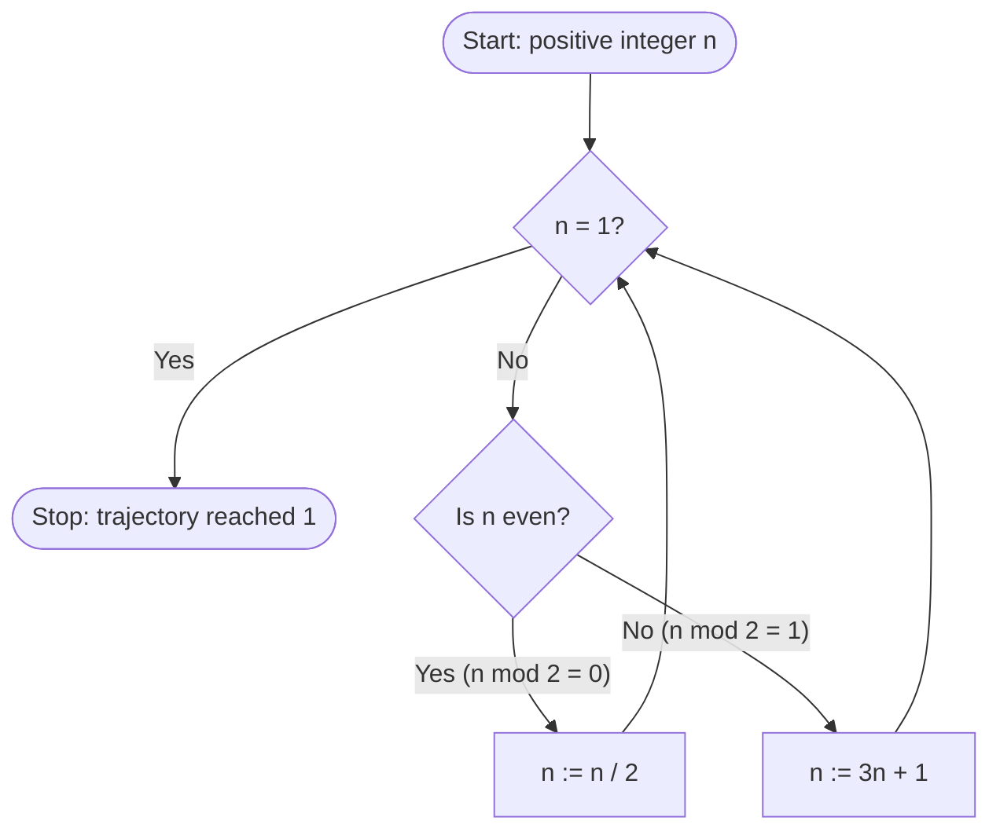

# Run log: wljs-mermaid (2026-10-22)

Request: "Draw the Collatz map's decision as a Mermaid flowchart."

## 1. Skills used

1. `wljs-mermaid` (local WLJS adaptation). As it instructs, I read `ROUTES.md` and the pinned upstream guide `~/.local/opt/wljs/app/resources/app/modules/wljs-api/mcp/dist/skills/mermaid.md`.

## 2. Steps

1. Read `ROUTES.md` and the upstream Mermaid guide. A `.mermaid` input cell is the documented way to make a diagram.
2. Created the scratch folder `.../wljs-mermaid/scratch/`.
3. `mcp__wljs__new_notebook` created notebook `002`. It shows in a WLJS window titled `llm-008.wln`.
4. `mcp__wljs__add_cells_batch` added 5 input cells:
   - `005` `.md`: title, plus the definition n -> n/2 (even), n -> 3n+1 (odd).
   - `006` `.mermaid`: the flowchart (source below).
   - `007` `.md`: a one-line lead-in to the check.
   - `008` Wolfram: `With[{collatz = If[EvenQ[#], #/2, 3 # + 1] &}, NestWhileList[collatz, 6, # != 1 &]]`
   - `009` Wolfram: `NotebookSave[EvaluationNotebook[], ".../work/CollatzFlowchart.wln"]`
5. Ran `mcp__wljs__evaluate_cell` on every cell. All evaluation went to the **WLJS kernel via `mcp__wljs__*`**, the default route, because the user should see the result in a notebook.
   - `005` and `007`: markdown output cells (`010`, `014`).
   - `006`: a Mermaid output cell (`012`, display "mermaid"). `read_content` shows that it holds exactly the diagram source.
   - `008`: `{6, 3, 10, 5, 16, 8, 4, 2, 1}`. This is the correct Collatz trajectory from 6, and each step follows one branch of the flowchart.
   - `009`: returned `RemoteNotebook[...]` and wrote `CollatzFlowchart.wln` (3379 bytes; contains the `.mermaid` cell).
6. Visual check: `tools/capture-wljs-windows.sh scratch/cap` captured the notebook window `llm-008.wln`. The markdown is rendered, and the Mermaid diagram has started drawing below its source: the rounded "Start: positive integer n" node, an arrow, and the top of the decision diamond. The rest is below the captured area.
7. Ran `mcp__wljs__project_cell` on `006` to see the whole diagram. That opened an "Application" window. Every capture after that failed (details under Problems), so I did not see the complete rendered diagram.

No Wolfram evaluation used `wolframscript`, `wolfram-direct` or `wsm-toolkit`. Nothing contacted the network. `$AllowInternet` was not changed.

Mermaid source (cell `006`):

```
.mermaid
flowchart TD
  S(["Start: positive integer n"]) --> D{"n = 1?"}
  D -->|Yes| E(["Stop: trajectory reached 1"])
  D -->|No| P{"Is n even?"}
  P -->|"Yes (n mod 2 = 0)"| H["n := n / 2"]
  P -->|"No (n mod 2 = 1)"| T["n := 3n + 1"]
  H --> D
  T --> D
```

## 3. Files

- Created `<repo>/tests/runs/2026-10-22/wljs-mermaid/work/CollatzFlowchart.wln`
- Created `<repo>/tests/runs/2026-10-22/wljs-mermaid/run-log.md` (this file)
- Scratch only, in `<repo>/tests/runs/2026-10-22/wljs-mermaid/scratch/`:
  - `cap/`: 3 PNGs. My window is `0x140001d_llm-008.wln.png`; the other two are other sessions' notebooks.
  - `cap2/`, `cap3/`, `cap4/`: empty, from failed captures.
  - `region.png`: an all-black ffmpeg region grab.
  - `app_*.xwd`: 0-byte files, deleted.

## 4. WLJS notebook

`<repo>/tests/runs/2026-10-22/wljs-mermaid/work/CollatzFlowchart.wln`. It is still open in the WLJS window titled `llm-008.wln`, along with the projected "Application" window for cell `006`. I closed neither.

## 5. Answer

The Collatz flowchart is in a WLJS notebook on your second monitor, saved as `work/CollatzFlowchart.wln`. The diagram is a `.mermaid` cell:



How it works: each pass first checks whether n has reached 1. If it hasn't, it checks whether n is even: even numbers are halved, odd numbers become 3n + 1, and the loop goes back to the check.

The notebook also has a Wolfram cell that checks the rule. Starting from 6 it gives 6, 3, 10, 5, 16, 8, 4, 2, 1. The diagram renders in WLJS. I saw its top in a screenshot but not the whole diagram, so please glance at the window.

## 6. Problems

- **Full rendering not seen.** The first capture (05:19) worked and showed the diagram starting to draw. After I opened the projected window with `project_cell`, every `xwd` capture failed on every WLJS window with `X Error: BadColor (invalid Colormap parameter)`, opcode 91 `X_QueryColors`. That covered my window, the two "Application" windows and the other sessions' notebooks, and I retried over about 2 minutes.
  - The cause is unknown. It started after the projected windows appeared (there are two "Application" windows; one may belong to another session), but that link is not proven.
  - An `ffmpeg x11grab` of the screen region came back all black, probably because the display is XWayland.
  - Because of this, the lower part of the diagram and its layout were not checked visually. The Mermaid source uses only standard flowchart syntax (quoted labels, edge labels), and WLJS produced a Mermaid output cell for it without any error.
- I left the projected "Application" window for cell `006` open (my own window). Nothing else failed and no messages were issued.
